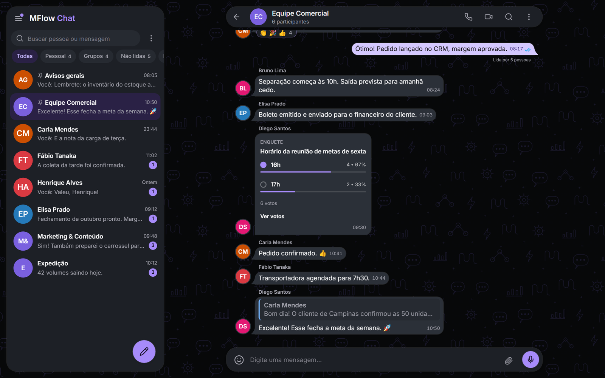
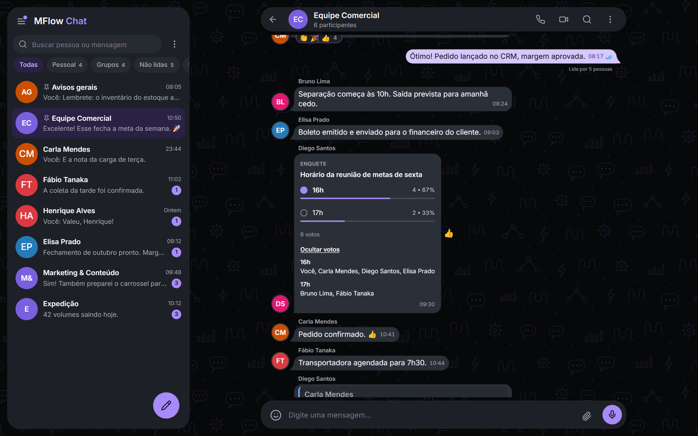
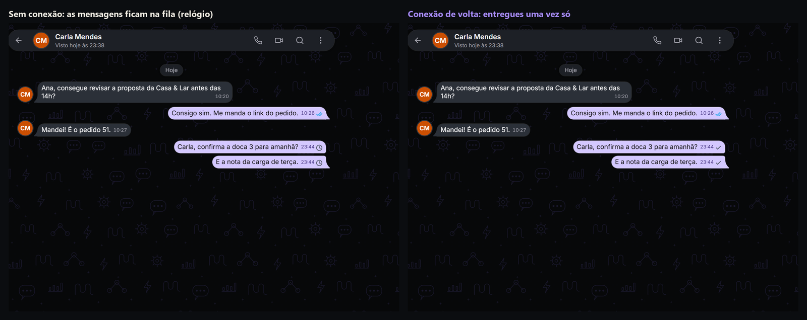
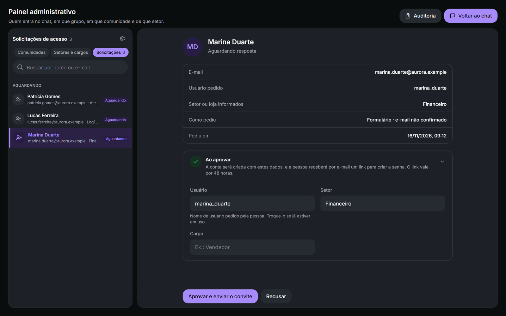
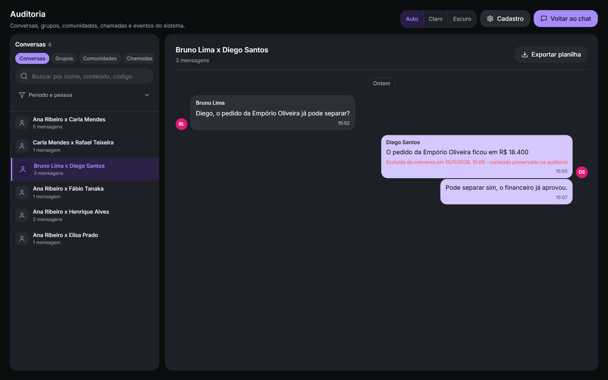
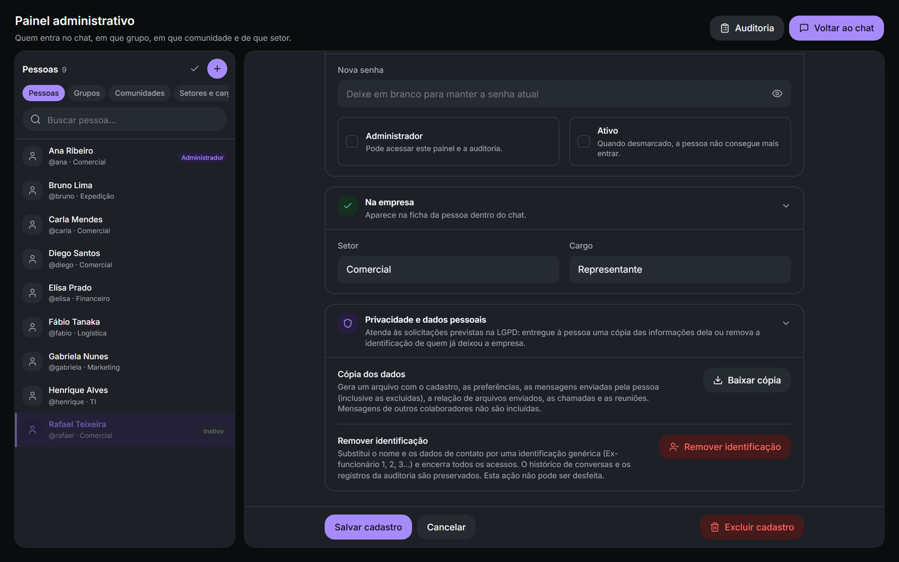
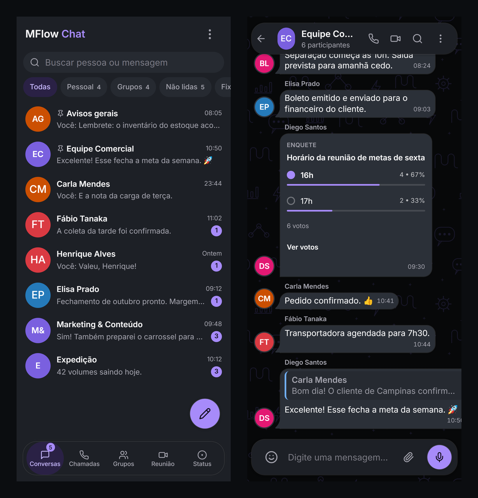
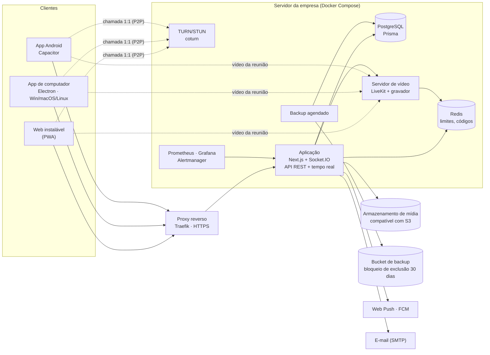

  <picture>
    <source media="(prefers-color-scheme: dark)" srcset="assets/logo-escuro.svg">
    
  </picture>

# MFlow Chat

**O chat corporativo da própria empresa: conversas, grupos, chamadas e reuniões num servidor que é dela, com controle de acesso, auditoria e LGPD desde o primeiro dia.**

---

## O problema

Em muitas empresas, a comunicação interna corre por aplicativos pessoais de mensagem. Funciona até o dia em que custa caro:

- **A informação não é da empresa.** Quando um funcionário sai, o histórico de negociações, combinados e arquivos sai junto, no celular dele.
- **Não há controle de quem entra.** Desligar alguém não tira essa pessoa dos grupos; um número esquecido continua lendo tudo.
- **Não há registro confiável.** Uma mensagem apagada desaparece, e numa disputa trabalhista ou comercial a empresa não tem o que apresentar.
- **LGPD sem resposta.** Dados de funcionários e clientes circulam em servidores de terceiros, sem prazo de guarda e sem como atender a um pedido do titular.
- **Ferramentas espalhadas.** Um app para mensagem, outro para reunião, outro para avisos gerais. Cada um com login, custo e regra próprios.

## A solução

O MFlow Chat é um sistema de comunicação interna completo, hospedado na infraestrutura da própria empresa. O funcionário usa como usaria um app de mensagens moderno (conversas, grupos, áudio, fotos, chamadas e reuniões) no navegador, no computador ou no celular. A empresa, por sua vez, decide quem entra, vê o que foi dito quando precisar (e isso fica registrado), define prazos de guarda e responde a pedidos de LGPD pelo painel.

Uma única aplicação web atende as três frentes: a web instalável, o app de computador (Windows, macOS e Linux) e o app Android. Uma correção feita na web chega a todos sem reinstalar nada.

---

## Funcionalidades

### Conversas e grupos

- Conversas individuais e em grupo, com confirmação de entrega e leitura em tempo real.
- **Comunidades**, que reúnem grupos de um setor ou projeto, cada uma com um canal de **Avisos** em que só administradores publicam.
- **Enquetes** com resultado ao vivo e a lista de quem votou em cada opção.
- Fotos (compressão automática ou envio em HD), vídeos, documentos, álbuns, **mensagens de voz** gravadas na hora e prévia de links.
- Responder, editar, apagar, fixar, reagir, favoritar e **encaminhar para até cinco conversas de uma vez**.
- **Status** que somem em 24 horas, **anotações** pessoais (uma conversa só sua), busca, silenciar e pastas de conversa.

### Envio que não perde mensagem

- Cada mensagem vai para uma **fila local** no instante do envio, aparece como "enviando" e só sai da fila quando o servidor confirma. Sobrevive a queda de rede, recarga da página e fechamento da aba.
- Reenviar nunca duplica: cada mensagem carrega um identificador gerado no aparelho, e o servidor recusa a segunda cópia.
- Mensagem recusada pelo servidor não fica "enviando" para sempre: aparece como não enviada, com o motivo.
- Fotos e vídeos sobem em segundo plano, com o progresso real na própria conversa. A pessoa não fica presa na tela de envio.

### Chamadas, reuniões e compartilhamento de tela

- **Chamada de voz e vídeo individual**, direto entre os dois aparelhos (P2P), com histórico e registro de chamadas perdidas.
- **Chamada em grupo** e **reuniões**, atendidas por um servidor de vídeo dedicado, que distribui a imagem sem sobrecarregar o computador de quem participa.
- Reunião **agora** ou **agendada**, com link para compartilhar, convite no painel de quem foi chamado, lembretes e antessala (testar câmera e microfone antes de entrar).
- **Compartilhamento de tela** com prioridade de nitidez sobre as câmeras, para que a planilha apresentada seja legível. Palco, fixar participante, tela cheia e janela flutuante.
- **Gravação de reunião com aviso**: quem entra é avisado na antessala e no cabeçalho da sala, e o aviso reflete o estado real da gravação.
- Quem só tem o link entra pela antessala; quem não foi convidado não vê a reunião em nenhuma lista.

### Acesso e segurança

- Entrada com usuário ou e-mail e senha, ou com conta Google.
- **Aprovação de acesso**: quem não tem conta faz um pedido, e o administrador aprova ou recusa no painel. Não existe cadastro público. Aprovado, a pessoa recebe um link de uso único (48 horas) para criar a própria senha.
- **Verificação em duas etapas** por aplicativo autenticador (TOTP) ou por código enviado por e-mail, com opção de confiar no computador por 30 dias. Trocar a senha desfaz essa confiança automaticamente.
- Sessões que acabam de verdade: sair, ser desativado ou ter o acesso encerrado pelo administrador derruba a pessoa na hora, inclusive as notificações daquele aparelho.
- Limite de tentativas em login, código e recuperação de senha.
- **Aceite dos termos de uso e da política de privacidade** antes do primeiro uso, registrado por versão.

### Painel de administração e auditoria

- **Cadastro**: pessoas, setores, cargos, grupos, comunidades e a fila de **solicitações de acesso**, com ações em massa (ativar, desativar) e redefinição da verificação em duas etapas.
- **Auditoria**: conversas, grupos, comunidades, chamadas (com a gravação, quando existe), reuniões, status e eventos do sistema, com exportação.
- **Apagar tira da conversa, não do registro.** Mensagem apagada continua visível na auditoria, com a marca de quando foi apagada.
- **Quem audita também é auditado.** Abrir uma conversa alheia, ouvir uma gravação ou buscar no texto das conversas gera uma linha no registro, com autor e data.
- Grupo com histórico não pode ser excluído pelo painel: a conversa da empresa não some por um clique.

### LGPD e guarda de dados

- **Pedidos do titular pelo painel**: baixar uma cópia dos dados de um funcionário (cadastro, preferências, acessos, mensagens enviadas e lista de anexos) e **remover a identificação** de quem já saiu da empresa, sem apagar o que foi dito.
- **Prazos de guarda automáticos**: fotos, documentos e áudios expiram em 12 meses; vídeos e gravações, em 90 dias. O arquivo sai, a mensagem fica, com o aviso "anexo removido pelo prazo de guarda".
- Notificações sem vazar conteúdo: o aviso do Android leva só um sinal, e o app busca o texto no servidor com a sessão da pessoa. A opção "mostrar o conteúdo da mensagem" desligada vale também para o push.
- Nenhum texto de conversa é enviado a serviço de tradução de terceiros.

### Plataformas e idiomas

- **Web instalável** (PWA), com notificações mesmo com o navegador fechado.
- **App de computador** para Windows (.exe), macOS (Intel e Apple Silicon) e Linux (.deb), com bandeja do sistema, início com o computador, atualização automática e tela própria quando está sem conexão.
- **App Android**, com notificações nativas, distribuído pela Google Play.
- Interface em **3 idiomas**: português (Brasil), inglês (EUA) e espanhol (Espanha), escolhidos por pessoa.
- Tema claro, escuro ou automático, papéis de parede e escolha da fonte do chat.

---

## Arquitetura

- **Clientes**: uma única aplicação web. O app de computador (Electron) e o Android (Capacitor) são cascas finas sobre ela, que acrescentam o que o navegador sozinho não faz: notificação nativa, bandeja, tela de sem conexão, seletor de tela para compartilhar e atualização automática.
- **Aplicação**: servidor Node próprio que une as páginas e a API (Next.js) ao canal de tempo real (Socket.IO) na mesma porta. Confere permissão a cada mensagem, grava no banco e distribui aos participantes.
- **Núcleo compartilhado**: as regras de domínio (como contar chamada perdida, quem pode ver uma reunião, limites da enquete) ficam num pacote sem dependência de plataforma, usado pela interface e pelas rotas da API, com um contrato de tipos conferido contra o servidor.
- **PostgreSQL + Prisma**: conversas, mensagens, reuniões, auditoria, sessões, aceites e pedidos de acesso. Migrations versionadas e aplicadas por script que distingue banco novo de banco existente.
- **Redis**: limites de tentativa, códigos de verificação (guardados só como resumo) e a comunicação entre o servidor de vídeo e o gravador.
- **Servidor de vídeo (LiveKit)**: atende chamadas em grupo e reuniões; o gravador grava a sala e devolve o estado da gravação ao chat.
- **Armazenamento S3**: fotos, vídeos, áudios, documentos e gravações, entregues sempre pela aplicação, que confere a permissão antes de cada arquivo.
- **Operação**: backup do banco a cada 6 horas enviado para fora do servidor, métricas protegidas, painéis e alertas.

---

## Decisões técnicas

1. **Sem perda e sem duplicata, por construção.** A fila de saída fica no aparelho e só esvazia com a confirmação do servidor; um índice único por remetente e identificador de cliente torna o reenvio idempotente. As duas garantias têm prova automatizada de ponta a ponta (queda de rede e reconexão).

2. **Dois caminhos de vídeo, cada um para o seu tamanho.** A chamada individual é P2P (barata e direta). Grupo e reunião passam por um servidor de vídeo com simulcast, dynacast e adaptive stream: cada pessoa envia uma vez, e cada tela recebe só o que está mostrando, no tamanho em que mostra. A tela compartilhada tem prioridade sobre as câmeras.

3. **O registro da empresa não depende da tela.** Apagar uma mensagem marca a exclusão e preserva o conteúdo; a auditoria mostra o original com o selo de apagado. A retenção remove o arquivo e mantém a mensagem. O painel recusa excluir grupo com histórico. Leituras administrativas deixam rastro.

4. **Acesso que se revoga de verdade.** A sessão é conferida no servidor, e não só pela assinatura do token: desativar alguém ou clicar em "Sair" encerra o acesso na hora. Pedido de acesso não leva senha; quem prova a posse do e-mail é o link de uso único. A confiança de "não pedir de novo neste computador" é por pessoa e por computador, e cai sozinha com a troca de senha.

5. **Privacidade na notificação.** O push do Android é só um sinal; o conteúdo é buscado com a sessão. O push da web leva o texto cifrado para o navegador de destino. Pessoa desativada deixa de receber notificação no mesmo instante.

6. **App de computador endurecido.** As travas de fábrica do Electron estão fechadas (sem execução como Node, sem injeção por variável de ambiente ou depurador, cookies cifrados em disco, conferência de integridade do pacote), para que outro programa da máquina não use o app para ler conversas ou gravar câmera e tela.

---

## Tecnologias

| Camada | Tecnologias |
|---|---|
| Interface | Next.js 16, React 18, TypeScript, Tailwind CSS, next-intl (3 idiomas), lucide-react |
| Tempo real | Socket.IO, WebRTC (P2P), LiveKit (SFU e gravação), coturn (TURN/STUN) |
| Servidor | Node.js 22, Next.js (servidor próprio), Zod, JWT, bcrypt |
| Dados | PostgreSQL, Prisma, Redis, armazenamento compatível com S3 |
| Notificações e e-mail | Web Push, Firebase Cloud Messaging, SMTP |
| Apps | Electron (Windows, macOS, Linux) com atualização automática; Capacitor (Android); PWA |
| Infraestrutura | Docker Compose, Traefik, backup agendado com rclone, Prometheus, Grafana, Alertmanager |
| Qualidade | Roteiros de prova de ponta a ponta, TypeScript estrito, ESLint, Prettier, GitHub Actions |

---

## Qualidade e segurança

- **Verificação em dois níveis** (um único comando):
  - **rápida**, sem infraestrutura: 11 conferências, incluindo tipos do código, do contrato e do núcleo compartilhado, contrato contra o servidor, regras de chamada, os três idiomas com os mesmos textos e a consistência dos apps de computador e Android;
  - **completa**: sobe um servidor de teste contra banco e Redis locais e executa **18 provas de ponta a ponta**, entre elas "mensagem chega", "fila offline não perde", "reconexão não perde", "ninguém lê conversa alheia", "sessão encerrada não entra mais", "auditoria mostra tudo e deixa rastro", "exportar e anonimizar uma pessoa sem apagar o que foi dito", "pedir acesso, aprovar e criar a senha", "sem aceite dos termos a ferramenta não abre" e "retenção apaga no prazo e preserva a mensagem".
- **Integração contínua** (GitHub Actions): validação do schema, conferência de tipos e contrato, lint e bloqueio de artefatos de build e de migrations fora do padrão. Os instaladores de computador são gerados numa máquina de cada sistema.
- **Revisões de segurança registradas** cobrindo login, permissões das rotas e do canal de tempo real, mídia, prévia de link (proteção contra acesso à rede interna), app de computador e infraestrutura.
- **Backup** do banco a cada 6 horas, enviado para um bucket externo com bloqueio de exclusão por 30 dias (nem a credencial principal da conta apaga uma cópia nesse prazo), com script de restauração e de conferência da restauração.
- **Monitoramento** com métricas protegidas por token, painéis e alertas por e-mail.

---

## Status

**Em produção, em uso interno** numa empresa, implantado em servidor próprio com Docker. Versão atual da aplicação: **2.0.17**. App de computador e app Android na versão 2.0.16. App para iPhone ainda não desenvolvido.

### Números (conferidos no código)

| | |
|---|---|
| Endpoints de API | 118 rotas, 153 métodos HTTP |
| Tabelas no banco | 33 modelos, 30 migrations |
| Idiomas | 3, com 3.333 textos de interface cada |
| Provas de ponta a ponta | 18 na verificação completa |
| Serviços em produção | 12 containers |

---

Projeto desenvolvido por **Matheus Silva · MFlow**
[mflowstudio.com.br](https://mflowstudio.com.br) · [github.com/portfolio-mflow](https://github.com/portfolio-mflow)

> O código-fonte é privado. Demonstração disponível mediante contato.
